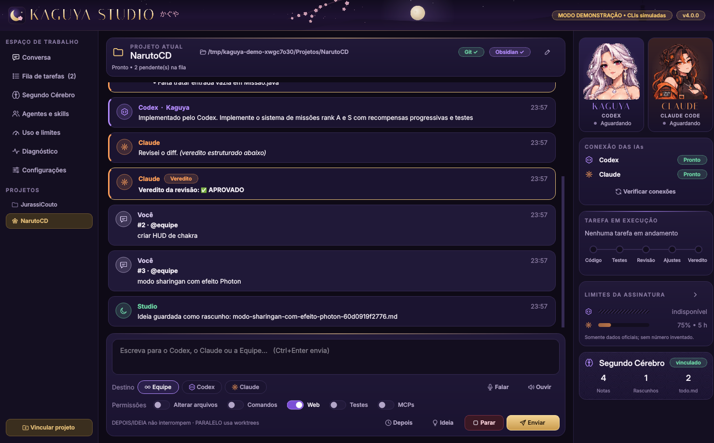

# Kaguya Studio 4

Ambiente Windows para trabalhar com **Codex** e **Claude Code** — juntos ou separados — usando as
**assinaturas que você já paga** (CLIs oficiais, sem API key), com o seu **Segundo Cérebro do Obsidian**.



## Começar

| Forma | Como |
|---|---|
| Executável | Baixe `KaguyaStudio-4.0.0-windows.zip` (artefato do workflow *Kaguya Studio (Windows)*), extraia e abra `KaguyaStudio.exe`. |
| Código-fonte | `INSTALAR.bat` (cria `.venv` local) → `INICIAR_KAGUYA_STUDIO.bat`. Requer Python 3.10+. |
| Demonstração | `DEMONSTRACAO.bat` — dados temporários e CLIs **simuladas**; não toca suas contas nem arquivos. |

Pré-requisitos das IAs: `npm i -g @openai/codex` + `codex login` (ChatGPT) e o Claude Code instalado + login
com a conta Claude Pro/Max. O Studio verifica tudo em **Diagnóstico** e mostra o que falta.

## Fluxo

1. **Vincular projeto** (barra lateral ou Ctrl+N): escolha ou cole o caminho; a pasta é verificada na hora
   (Git, permissão de escrita, subpasta de repositório).
2. **Segundo Cérebro**: conecte o vault do Obsidian (global, independente dos projetos; cada projeto pode ter
   o seu). Clique em *Indexar*.
3. **Diagnóstico**: confirme Codex e Claude (versão, login por assinatura, correções sugeridas).
4. **Conversa**: escolha *Equipe*, *Codex* ou *Claude* e as permissões da tarefa:
   - *Alterar arquivos* (exige Git) • *Comandos* (testes/builds) • *Web* • *Testes* (o Studio roda os testes) • *MCPs*.
   - `DEPOIS:` / `IDEIA:` guardam sem interromper; `AGORA:` pede confirmação para interromper;
     `PARALELO:` + linhas `@codex: …` / `@claude: …` dividem o trabalho em worktrees Git.

**Equipe**: Codex implementa → o Studio verifica (Git, testes autorizados) → Claude revisa com veredito
estruturado → Codex corrige na mesma sessão → … até aprovar ou atingir o limite de ciclos (padrão 2).

## O que o Studio garante (e não as IAs)

- Consulta o Obsidian em toda tarefa e envia as notas como **dados** (com fonte), nunca como instruções.
- Extrai `APRENDIZADOS`/`ERROS`/`REFERÊNCIAS` das respostas e cria **rascunhos** para você aprovar
  (notas novas nunca sobrescrevem as existentes; `tasks/todo.md` é só lido).
- Nunca marca como concluído o que falhou; pausa a fila após falha ou limite.
- Limites da assinatura **somente de fontes oficiais**; quando não há dado, mostra "indisponível" e os
  atalhos para `/status`, `/usage` e as páginas oficiais.
- Nunca usa API faturada: chaves de API e variáveis de provedor não são repassadas às CLIs.

## Estrutura

```
kaguya/            núcleo (sem Qt): paths, store, cli/, orchestrator/, vault/, inventory, usage, voice/
kaguya/ui/         interface PySide6 (theme, widgets, páginas, mascotes, voz)
assets/            branding, backgrounds, ornaments, icons, mascots, states, fonts, previews
tools/             gerar_assets.py, previa_mascotes.py, build_windows.py
tests/             60+ testes (CLIs simuladas, UI offscreen, regressões da V3.4, CLIs reais sem conta)
legacy_v3_4/       código da V3.4 (referência e testes de regressão)
docs/              AUDITORIA.md, MIGRACAO.md, TESTES.md, handoff/
```

## Testes

`TESTAR.bat` (ou `python -m unittest discover -s tests -t .`). Detalhes do que foi e do que **não** foi
validado: [`docs/TESTES.md`](docs/TESTES.md). Auditoria da V3.4: [`docs/AUDITORIA.md`](docs/AUDITORIA.md).
